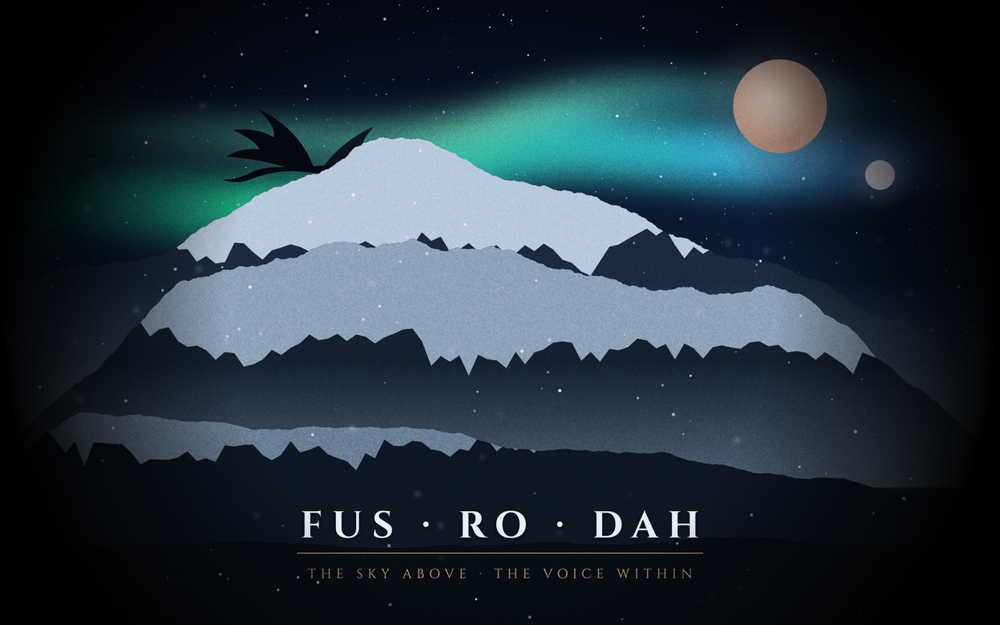

# Skyrim theme for Omarchy

A fan-made [Omarchy](https://omarchy.org) theme inspired by The Elder Scrolls V: Skyrim.
It uses slate and cold stone, frost blue and weathered Nord gold, with
Yaru-prussiangreen icons. Window borders fade from frost to gold.

> **Made with AI.** Claude (Anthropic) made this theme: the colours, the wallpapers
> (drawn by a script Claude wrote) and this README. Minihercules317 came up with
> the idea, made the design choices and tested it on Omarchy.

## Install

    omarchy theme install https://github.com/Minihercules317/omarchy-skyrim-theme

Or go to Omarchy menu > Install > Style > Theme and paste the URL. To switch to it later:

    omarchy theme set skyrim

## Wallpapers

Both wallpapers are original art (aurora, twin moons, snowy peaks, dragons),
drawn as vector graphics by a script. They don't use any artwork from the game.

1. `1-aurora.jpg`: aurora over the mountains, "FUS · RO · DAH"
2. `2-throat-of-the-world.jpg`: the same peaks at dawn, with dragons, "The Throat of the World"

Cycle wallpapers with `omarchy theme bg next`.

## Optional: medieval fonts (MedievalSharp and Cinzel)

Omarchy fonts are global and aren't part of a theme, so switching themes never changes them.
To use these fonts too:

    mkdir -p ~/.local/share/fonts/skyrim
    cp ~/.config/omarchy/themes/skyrim/fonts/*.ttf ~/.local/share/fonts/skyrim/
    fc-cache -f
    omarchy font set "MedievalSharp"
    # optional, for app interfaces (GTK):
    gsettings set org.gnome.desktop.interface font-name 'Cinzel 11'

MedievalSharp isn't monospaced, so `omarchy font list` won't show it, but `font set`
still works. Its letters are wide: size 8 fits fastfetch in foot
(`font=MedievalSharp:size=8` in `~/.config/foot/foot.ini`). Add `font-monospace-warn=no`
under `[tweak]` to silence foot's warning about it.

To go back to the default fonts:

    omarchy font set "JetBrainsMono Nerd Font"
    gsettings set org.gnome.desktop.interface font-name 'Adwaita Sans 11'

## License

- Theme files and the wallpapers: MIT, see [LICENSE](LICENSE).
- `unlock.png` and `preview-unlock.png`: the Omarchy logo, recoloured. MIT, © David Heinemeier Hansson.
- Fonts: SIL Open Font License, see `fonts/OFL-*.txt`.

This is an unofficial fan project, not affiliated with or endorsed by Bethesda.
Skyrim and The Elder Scrolls are trademarks of ZeniMax Media.
